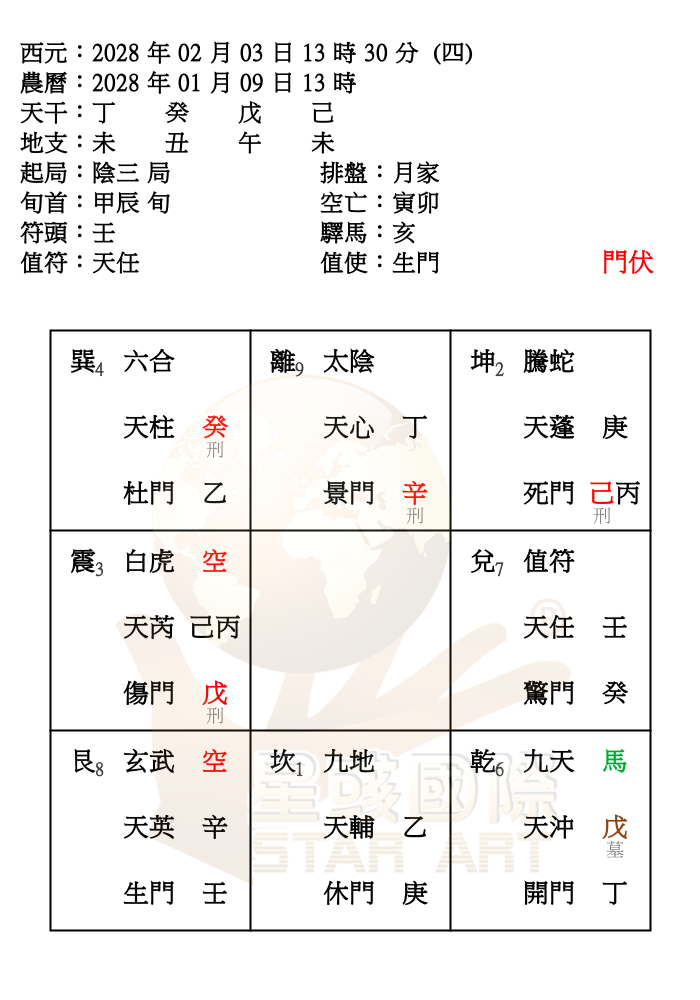
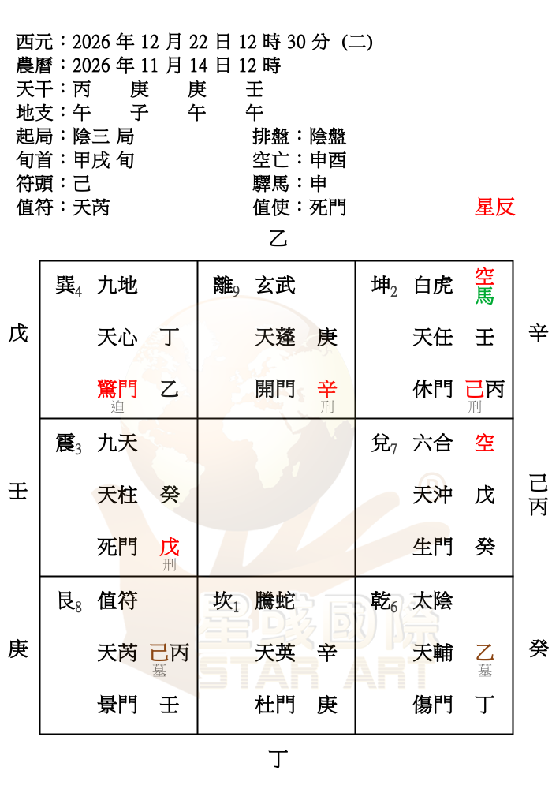

# 星彧實盤續查：月家、年家與日家（V16，2026-10-24）

後續 V17 已修正陰盤冬至前夕23時提早轉陽，冬至當天分時仍待釐清，見 [V17 冬至前夕續查](winter-eve-check-2026-10-24.md)。本頁保留 V16 當輪結果。

**判讀更正／後續V18**：原文將2027-12-22 04:55誤讀為陰二，原盤實際為陽二，表格已訂正。冬至分時後續已完成129組對照，見 [V18逐日紀錄](winter-daily-check-2026-10-24.md)。

## 本輪來源與範圍

基準為 main `b8575f4ea71b4060e1d51ee10740e1e4e11459b5`（V15）。使用者要求立即重試後，Browser 已成功連到 Chrome 的已登入星彧網站，透過可見選單與「開始排盤」產生下列 **31 組**盤圖；讀取圖片並放大辨識，沒有讀取網站隱藏程式或繞過登入。這些是新增實盤對照，不是前一輪結構掃描的數量。

關鍵盤圖保留在 [reference-20261024](reference-20261024/)；WebP 為原圖無損轉存，未更改盤面文字或配置。以下敘述只涵蓋列出的輸入與欄位，不推論所有年份、流派都相同。

## 已修正一：日／月／年家顯示四柱仍用近似日界

V15 在 2028-02-03 13:30 已顯示戊申年、甲寅月，網站三種系統均顯示丁未年、癸丑月；2028-02-04 15:00 也尚未換年、月，15:40 才切換。四柱改用已有的 `lunar-javascript 1.7.7` 精確交節時分，與陰盤／時家相同。日柱與時柱的 23 時換日保持原規則。

日家本輪只修改四柱顯示，沒有修改日家起局、冬夏至錨點、九星、八門、天地盤或外圈公式。

## 已修正二：月家起盤月柱與顯示月柱是兩個分界

| 月家輸入 | 網站四柱年／月 | 網站起盤結果／V16 |
|---|---|---|
| 2028-02-03 13:30 | 丁未／癸丑 | 陰三、甲辰旬、天任值符／生門值使，採癸丑月盤 |
| 2028-02-03 23:30 | 丁未／癸丑；日柱己未、時柱甲子 | 陰三、甲寅旬、天柱／驚門，已採甲寅月盤 |
| 2028-02-04 15:00 | 丁未／癸丑 | 陰三、甲寅旬、天柱／驚門 |
| 2028-02-04 15:40 | 戊申／甲寅 | 與 15:00 同盤，四柱改變 |
| 2026-03-05 13:30 | 丙午／庚寅 | 陰五、甲申旬、天沖／傷門，採辛卯月盤 |

符合這些盤例的規則：月家起盤取子初換日後民用日期的「交節整日」月柱，顯示四柱仍按實際交節時分。V15 的近似公式在 2028 年提前一天，也把 2026 驚蟄補成 3/6，兩種情況都會造成轉盤偏差。

修正使用 `Solar.fromYmd(換日後日期).getLunar().getMonthGanIndex()`／`getMonthZhiIndex()`；月家數值年份與年支採同一日期的立春整日分界。介面明示「起盤月柱」與整日規則，避免顯示四柱仍是癸丑卻採甲寅盤時讓使用者誤以為未重算。

核對 2028-02-03 13:30、2028-02-04 15:40、2026-03-05 13:30 的九星、八門、天地盤；前後兩組立春時分的盤面相同。網站這些日／月／年家圖未呈現可供抄錄的外圈天干，**本輪不宣稱外圈已與網站核對**；外圈共用公式保留，以結構與相容性檢查保護。

## 已修正三：年家三元局數與起盤年柱不能共用同一個年份

年家起盤年柱在立春實際時刻變動：2028-02-03 13:30 與 2/4 15:00 網站同為丁未年盤；2/4 15:40 才轉戊申年盤。V15 近似式提前到 2/3，九星與八門都會轉錯。本輪已按網站盤圖抄錄立春前後的九星、八門與天地盤。

另外，三元局數按**子初換日後的西元年**切換，不能等到立春：

| 年家輸入 | 網站／V16 | V15 問題 |
|---|---|---|
| 1924-01-01 12:30 | 陰四、癸亥年柱 | 尚取前一年三元，陰一 |
| 1984-01-01 12:30 | 陰七、癸亥年柱 | 陰四 |
| 2043-12-31 22:30 | 陰七、癸亥年柱 | 此案例保留 |
| 2043-12-31 23:30 | 陰一、癸亥年柱，日柱己酉／甲子時 | 仍陰七 |
| 2044-01-01 00:30 | 陰一、癸亥年柱 | 仍陰七 |
| 2044-02-03 12:30 | 陰一、癸亥年柱 | 近似立春日又會提前年柱 |
| 2044-02-04 12:30 | 陰一、癸亥年柱 | 局數切換不可與年柱綁定 |

保留原本 1864 基準、180 年三元及全陰遁公式，只把局數與元序的輸入年份改成換日後西元年；起盤年干支則取實際交節時刻的年柱。沒有硬編 1924、1984 或 2044 等個別日期。

立春前後盤圖：[2028-02-04 15:00](reference-20261024/year-20280204-1500.webp)、[15:40](reference-20261024/year-20280204-1540.webp)；跨年證據：[2043-12-31 23:30](reference-20261024/year-20431231-2330.webp)。

## 日家兩組實盤

| 輸入 | 網站／V16 |
|---|---|
| 2028-02-03 13:30 | 丁未年／癸丑月，陽一、甲寅旬、天心／開門；九星與八門已抄入測試 |
| 2028-02-04 15:00 | 丁未年／癸丑月，陽二、甲寅旬、天柱／驚門 |

只證明這兩組結果相符；日家跨冬夏至、其他年份的局數公式仍須更多網站樣本，不能把結構掃描稱作實盤驗證。

## 陰盤冬至：已重新確認差異，仍未猜測替換規則

本輪確實重新放大核對，下表是 **14 組網站結果**，不是自家引擎預期值。

| 陰盤輸入 | 網站局數 |
|---|---|
| 2025-12-21 18:30 | 陰二 |
| 2026-12-22 12:30、18:30、22:30 | 陰三、陰六、陰八 |
| 2026-12-22 23:30；12-23 00:30 | 陽七、陽七 |
| 2027-12-22 04:55、05:00 | 陽二、陽三（04:55判讀已更正） |
| 2027-12-22 13:30、23:30 | 陽七、陽一 |
| 2028-12-21 10:55、11:00 | 陰五、陰六 |
| 2028-12-21 16:30、17:30 | 陽八、陽九 |

這些結果既不支持 V15 固定中午 12 時切換，也不能全用夏至那套當年天文交節時分解釋。例如套件當年冬至為 2026-12-22 04:50:14、2027-12-22 10:42:10、2028-12-21 16:19:41，與網站部分年份切換明顯不同。網站內部原因未知，沒有讀取隱藏程式確認；**不能宣稱它必然採用前一年時刻或某個固定時辰。**

冬至仍保留 V14／V15 行為，明列未完成。2026-12-22 12:30 網站陰三、自家仍陽三；2027-12-22 05:00 網站陽三、自家仍陰三。下一步須再取得更多年份、分界前後與日期前後的樣本，建立通則；不為這兩天寫特殊分支。

## 回歸、修改範圍與驗證限制

- `npm test`：**59 項通過**；新增七項網站盤例測試，保留舊盤例、十二長生、日期導覽及相容性測試。
- `npm run build`、`git diff --check` 通過。
- `npm run audit:qimen`：五種系統各 20,678 組、共 **103,390 組結構檢查通過**。這只檢查排列、取值與完整性，不等同與網站逐盤相符。
- 另對 V15 每系統各 960 組（2025–2028、每月 1/4/21/28、00/05/11/16/23、30 分）比較：陰盤與時家完整輸出 **各 960 組完全一致**；日家 960 組盤面全同，27 組四柱顯示改變；月家 2 組盤面改變、27 組四柱改變；年家 6 組盤面改變、27 組四柱改變。年家元序資訊另隨西元年修正，月家新增起盤月柱欄位，不把新增欄位誤計為盤面變化。
- 月／年／日家的完整輸出快照在新增網站證據後有意更新為 V16；時家維持 V13 快照，陰盤一般日期維持原基準。沒有讓快照要求阻止已確認的修正，也沒有刪除已失敗的邊界案例。
- 五種宿主時區比較新增月家／年家立春時分、年家跨三元及日家閏年案例。陰盤夏至與立春、時家置閏錨點及中五起算均未改寫。
- 剩餘範圍：陰盤冬至未修復；日家冬夏至與其他年份仍待更多實盤；三種長週期盤的外圈天干未從網站圖驗證。未宣稱五種排盤全部正確。
